<div align="center">
  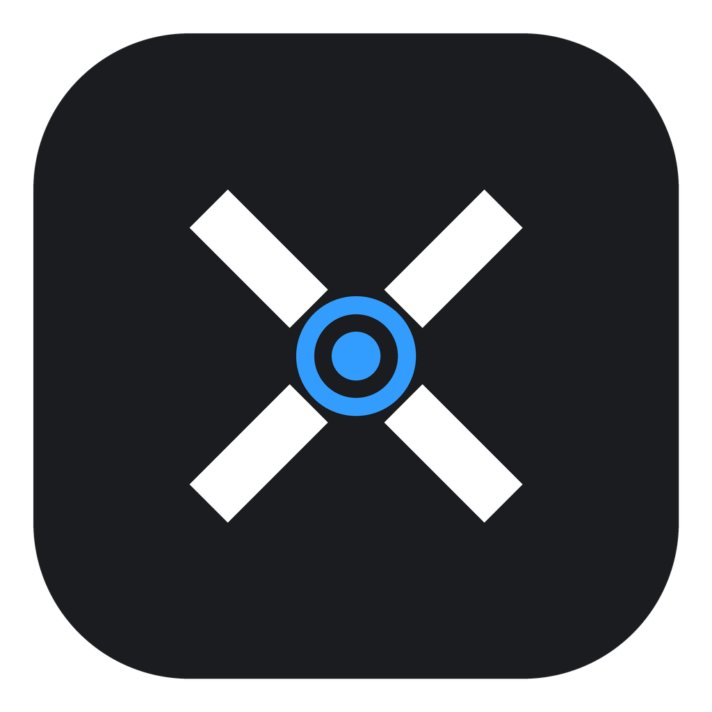
  <h1>Xen</h1>
  <p><strong>从画面采集到视觉控制，从数据审核到模型训练。</strong></p>
  <p>C++20 构建的 Windows 实时视觉工作台</p>
  <p>
    
    
    
    
    <a href="LICENSE"></a>
  </p>
  <p>
    <a href="#功能概览">功能概览</a> ·
    <a href="#界面预览">界面预览</a> ·
    <a href="#实测案例">实测案例</a> ·
    <a href="#快速开始">快速开始</a> ·
    <a href="#项目架构">项目架构</a> ·
    <a href="#构建与开发">构建与开发</a> ·
    <a href="#仓库结构">仓库结构</a> ·
    <a href="#使用指南">使用指南</a> ·
    <a href="assets/guide/releases/2026-10-12.md">源码更新记录</a> ·
    <a href="SUPPORT.md">使用帮助</a>
  </p>
</div>

---

Xen 将**采集、检测、瞄准、辅助控制、数据整理和训练**集中在一个原生桌面界面中。既能处理本机桌面画面，也能接入双机视频源；使用不同的推理后端适配硬件，并保留可回放、可比较的运行记录。

项目追求“小而美的瑞士军刀”：让每项能力有明确入口，让配置、数据和结果可以追溯。

**当前源码说明核对于 2026-10-12**：[main 更新与验证记录](assets/guide/releases/2026-10-12.md)。本轮已合入弹道候选内容确认、文件选择器取消与退出回收、模型和数据集身份一致性等修复；三后端本地构建及主辅机差量交付已完成。软件测试、部署完整性和真实设备效果分别记录。

[2026.10.07 发布说明](assets/guide/releases/2026-10-07.md)与其单文件教程是历史快照；该次 GitHub Release 附件不含完整程序包。完整便携包采用本地交付，本轮未新建 GitHub Release。日常使用以本仓库的[使用指南](#使用指南)为准。历史实战接受范围见 [2026.09.29 记录](assets/guide/releases/2026-09-29.md)，身法实录见下方[演示](#身法演示)。

## 功能概览

| 模块 | 可以做什么 |
| :-- | :-- |
| **画面采集** | 本机 DXGI 桌面采集，以及 UDP MJPEG、XUDP JPEG、NDI 视频输入；支持双机工作流。 |
| **模型推理** | 通过 ONNX Runtime 运行检测、分割、姿态和旋转框模型；提供模型选择、类别筛选和热重载。 |
| **瞄准控制** | 目标追踪与选择、范围及瞄点设置、延迟补偿；结合 GSI 上下文进行可选的阵营筛选。 |
| **辅助控制** | 自动扳机、移动急停联动、旋转跳与 Long Jump、按武器管理弹道；统一显示输入许可、暂停与故障原因。 |
| **采集与审核** | 按需保存原图和预测，整理重复及疑难样本，批量预览、人工修订并导出训练数据。 |
| **模型训练** | 专用 Python 环境检查、可信 PT 校验、冻结数据集、训练与取消/恢复、独立评价、ONNX 导出和手动采用候选。 |
| **诊断与回放** | 性能信息、运行报告、输入录制、单 Run 离线复盘和对照工具，帮助定位问题与比较结果。 |

**推理后端**：CPU · CUDA · TensorRT · DirectML · OpenVINO<br>
**输入后端**：Win32 SendInput · KMBOX NET · MAKCU

各后端的能力与依赖不同：

| 功能 | 当前输入后端边界 |
| :-- | :-- |
| 鼠标移动 | 提供 Win32 SendInput、KMBOX NET、MAKCU 后端，仍受各自配置与输出许可约束。 |
| 自动急停、旋转跳与 Long Jump | 当前需要 KMBOX NET 的键盘输出与物理输入读回能力；定时 Ctrl 另检查 Left Ctrl 能力。 |

协议能力和 ACK 不证明真实游戏效果。模型也需满足对应输出契约；支持某种任务类型不等于任意 ONNX 都能直接使用。

## 界面预览

以下图片记录 2026.09.29 发布时的界面，统一使用白色主题；后续新增入口以当前程序和指南为准。画面由生产 UI 渲染，使用无设备演示状态与示例路径；展示功能入口，不代表实时性能或实战效果。

### 采集与批量审核

素材保存、状态查看和批量审核在同一页面完成。未检测到目标的图片仍需审核，不会直接当作负样本。

<p align="center">
  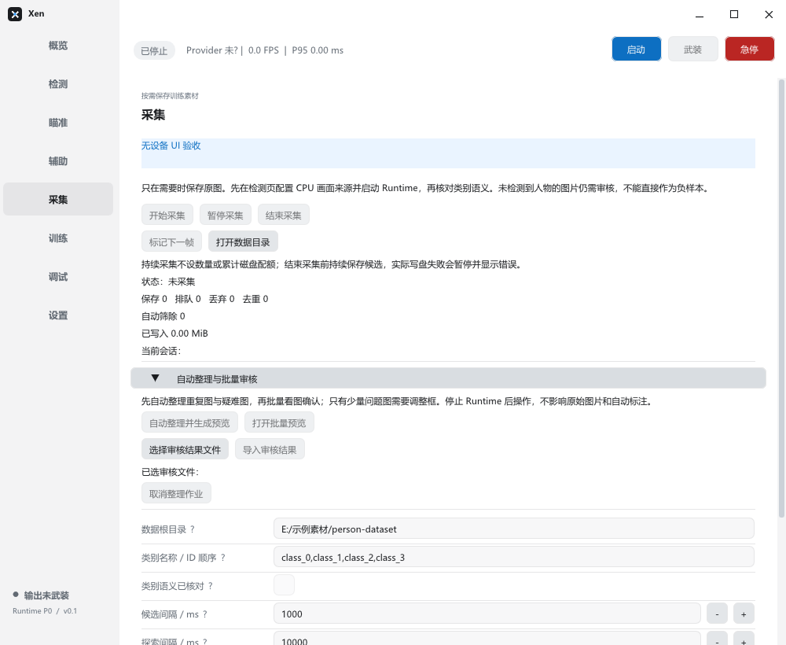
</p>

<table>
  <tr>
    <th width="50%">瞄准与阵营筛选</th>
    <th width="50%">训练与候选评价</th>
  </tr>
  <tr>
    <td>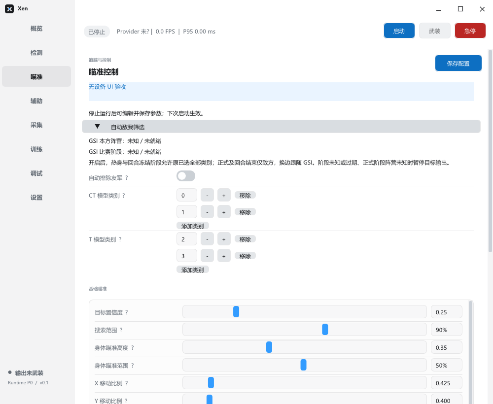</td>
    <td>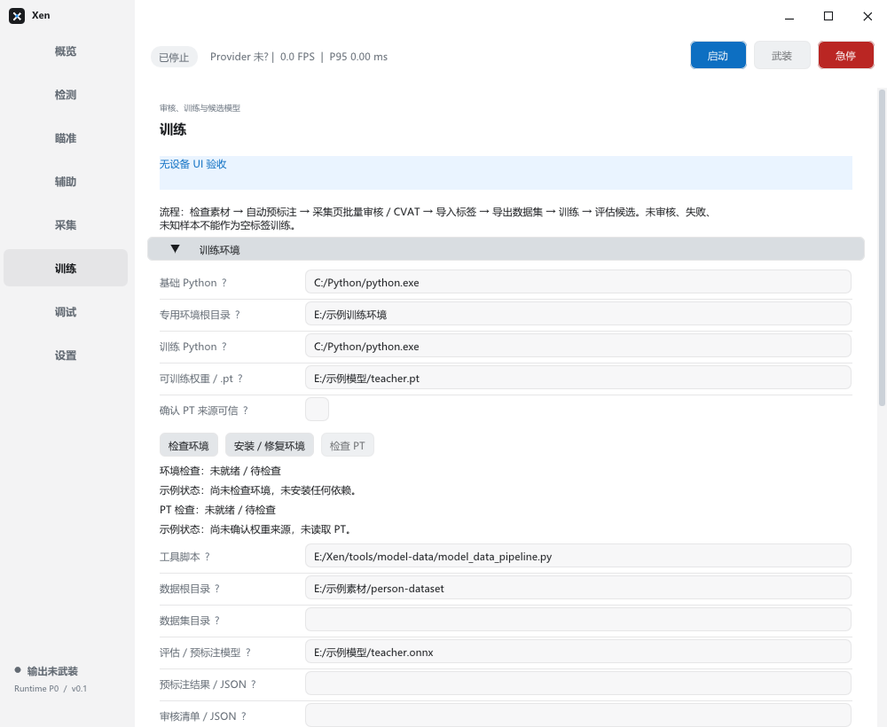</td>
  </tr>
  <tr>
    <td>按模型设置类别映射，调整目标选择和控制参数。</td>
    <td>检查专用环境与可信权重，准备训练和独立评价。</td>
  </tr>
</table>

## 实测案例

以下历史实测素材来自局域网双机环境，非主机独立运行，测试使用完美及 5E 对战平台；不覆盖后续身法增量。

以下片段来自 2026-09-29 的实际测试录像。用户完成压枪、急停＋扳机及实战测试后，反馈整体效果可以接受。片段保留原速，裁去昵称和聊天区域；GIF 为轻量预览，点击下方 MP4 可查看更清晰的版本。

| 压枪 · 5 秒 | 急停＋扳机 · 6 秒 |
| :--: | :--: |
| 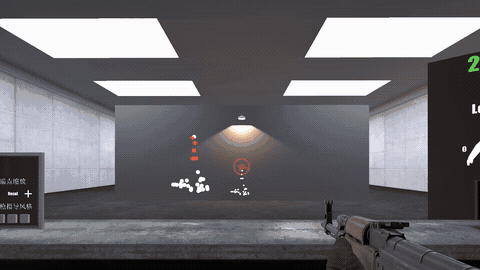 | 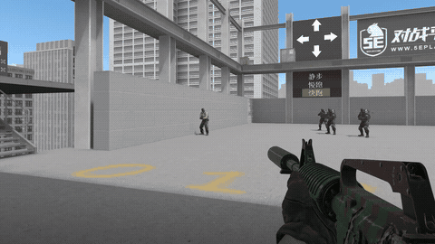 |
| [查看 MP4](https://github.com/hpsazz1/Xen/releases/download/v2026.09.29/recoil.mp4) | [查看 MP4](https://github.com/hpsazz1/Xen/releases/download/v2026.09.29/stop-trigger.mp4) |

<p align="center">
  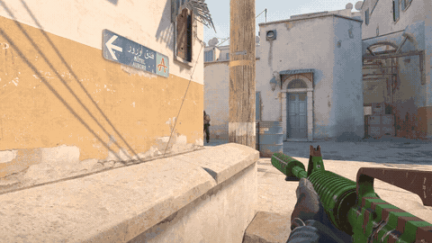
</p>

<p align="center">实战片段 · 5 秒 · <a href="https://github.com/hpsazz1/Xen/releases/download/v2026.09.29/match.mp4">查看 MP4</a></p>

精选片段展示使用场景，不据此推导命中率、急停时延或跨环境效果。[素材说明](assets/readme/showcase/README.md)记录时长、处理方式和权利边界。

### 身法演示

2026-10-07 补充的用户实录，展示 Long Jump 与旋转跳。两段保留原速和完整动作，裁去顶部头像区域；仅展示录像中的效果，不代表所有地图、设备或参数下的表现。

| Long Jump · 4.4 秒 | 旋转跳 · 7.5 秒 |
| :--: | :--: |
| 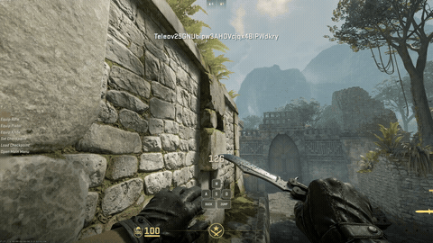 | 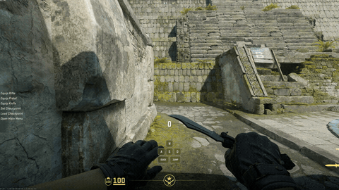 |

在**辅助 → 身法**中分别开启和设置触发方式。具体用法见[身法简明说明](assets/guide/movement.md)，剪辑范围见[素材说明](assets/readme/showcase/README.md#身法展示)。

在**调试 → 身法编排**中从“已保存方案”选择并载入身法，执行仍使用原测试热键。语音助手已移除，已有方案和动作保持兼容。

烟雾配方在独立的**调试 → 道具测试**中管理，日常统一使用[OBS 道具插件](tools/obs_grenade_overlay/README.md)：小键盘右键呼出或隐藏主机菜单，按站位或落点分类，地图和阵营跟随 GSI。点选后返回游戏并显示右上角参考图，上键找点、下键投掷、左键取消，End 全局急停。PgUp采集站位图；试投成功并恢复正确站位瞄角后按PgDn采集瞄点图，按住Ctrl蹲姿时也可使用。插件自动采图、短命名、打包发送；不再单独启动采集工具。手机选择入口已移除，HTTP 5015 保留为插件内部接口。详见[道具操作说明](assets/guide/grenades.md)。

### 追踪、补偿与预测

三段按相同倍率放大准星附近画面，右上角叠加运行日志中的**基础瞄点 → 预测瞄点**及两点距离。绿点为基础瞄点，橙圈为预测瞄点；像素值按原画面计算，放大不改变数值。

**基础追踪** · 原录像 1–6 秒 · [查看高清 MP4](https://github.com/hpsazz1/Xen/releases/download/v2026.09.29/tracking.mp4)

<p align="center">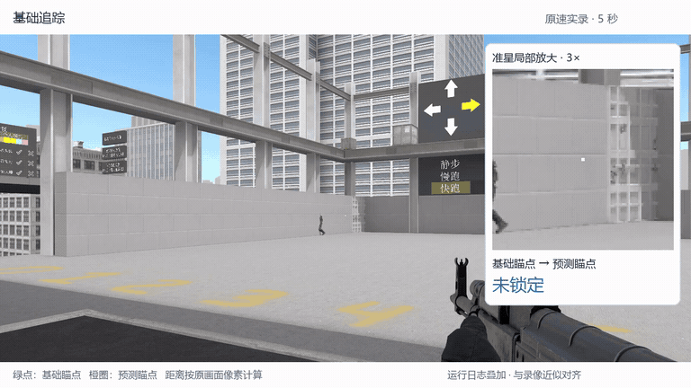</p>

**基础＋补偿** · 原录像 2–7 秒 · [查看高清 MP4](https://github.com/hpsazz1/Xen/releases/download/v2026.09.29/tracking-compensation.mp4)

<p align="center"></p>

**基础＋补偿＋预测** · 原录像 16–21 秒 · [查看高清 MP4](https://github.com/hpsazz1/Xen/releases/download/v2026.09.29/tracking-prediction.mp4)

<p align="center">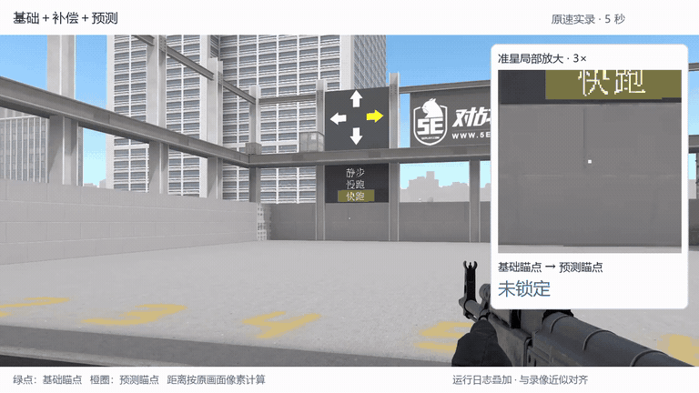</p>

三段均开启死区和软化区：死区为 **1.5 px**，软化区半径为 **30%**，最小强度为 **20%**。除补偿、预测开关外，其余瞄准配置一致。未开启预测时两点重合，显示 0 px；延迟补偿作用于控制过程，不能用这段连线的长度衡量。日志与录像经目标位置近似对齐，标记用于解释瞄点关系，不作为逐帧物理时延测量；未锁定时不显示有效距离。

## 快速开始

### 1. 选择运行方式

| 使用方式 | 入口 | 注意事项 |
| :-- | :-- | :-- |
| 已交付的便携包 | 包根目录的 `Start-Xen.cmd` | 相对路径启动，不绑定开发机目录；随包 `Xen-guide.html` 按该包导出日期阅读。 |
| 标准多后端包 | 包根目录的 `XenLauncher.exe` | 由启动器选择匹配的 Worker，不直接启动 `runtimes/` 内的程序。 |
| 自行编译 | 构建输出中的 `Xen.exe` | 先完成下方构建步骤，依赖随构建配置部署。 |

已交付完整包带有指定模型、默认配置和运行库，无需安装开发 SDK；GitHub 源码压缩包不含这些运行依赖。需要 Windows x64 及所选后端对应的硬件/驱动；CUDA、TensorRT 需要受支持的 NVIDIA GPU，OpenVINO 默认选 CPU。个人设备和双机连接信息在界面填写。

### 2. 接通画面与模型

新配置默认使用 CPU 推理与本机桌面采集，物理输出和辅助总开关关闭。删除 `config.ini` 后启动会按代码发行默认重建；个人设备地址、NDI 源和双机连接信息需重新填写，已有配置不会自动覆盖。

1. 将模型放入程序数据根的 `models/`，在**检测**页刷新、选择并应用。
2. 设置画面来源和推理后端；双机使用时先确认源端视频可达。
3. 手动启动 Runtime，保持输出未武装，核对预览、类别、日志与后端状态。
4. 停止 Runtime 后修改并保存控制参数，再按需要启用功能。

启用源端焦点桥接后，若认证环境变量缺失或桥接客户端初始化失败，Runtime 仍可采集和检测，并显示具体警告；瞄准、自动急停、扳机和压枪继续等待有效源状态，不会因降级绕过焦点检查。修复认证启动环境后，停止并重新启动 Runtime。身法保留原有人工输出开关和急停规则，不额外依赖源焦点。

> 真实输出须有明确授权；可从界面手动启动，也可由已授权的有界远程调试任务执行。保留输入状态检查、按住启用及 End 急停。设备 ACK 只证明协议完成，不能代替实际效果观察。

详细运行记录默认关闭。在**设置 → 日志与运行记录**开启后，保存 Runtime 逐帧报告、全程归档和压枪批次；关闭立即停止新增样本，后台封尾后停止增长，已有资料保留。保存配置后下次启动沿用。普通日志、崩溃诊断与主动采集独立。

视频与日志对照可使用[独立录制程序](tools/recorder/README.md)：桌面“Xen 独立录制”入口默认主屏全分辨率、240FPS、不采集系统声音，首尾自动把SYNC写入视频并保存时间索引。先开启辅机详细记录并启动Runtime，再开始录制；停止时等“已保存录像和同步索引”。录制程序独立于现有OBS320×320/NDI，急停参数保持。

### 3. 按任务进入对应页面

| 想做的事 | 从哪里开始 |
| :-- | :-- |
| 调整识别模型、阈值和画面输入 | **检测** |
| 调整追踪、范围、瞄点和阵营类别 | **瞄准** |
| 配置身法、扳机、急停或弹道 | **辅助** |
| 保存新场景素材、审核标注 | **采集** |
| 检查训练环境、训练并评价候选 | **训练** |
| 查看运行诊断、录制与离线结果 | **调试** |
| 汇总已有 Run 的异常、配置身份及画面锚点 | [单 Run 离线复盘](assets/guide/tools.md#单-run-离线复盘)，使用 `scripts/review_run.py`。 |

离线复盘在仓库根使用 Python 3.11+ 执行：

```powershell
py -3 -B scripts/review_run.py --run "C:\path\to\existing-run" --output "C:\path\to\new-review"
```

将示例路径替换为已有归档与新的报告目录；生成 `index.html`、`REVIEW.md` 和 `review.json`。只读原始归档，缺项标为未知，近似画面对齐不等于逐帧真值。

## 数据与模型工作流

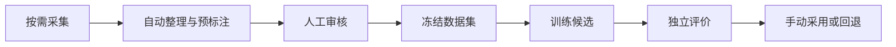

双机部署中，**数据采集可在辅机进行，训练在主机进行**；辅机仍可承担实时采集、推理和控制。按会话或对局划分训练、验证和测试集，避免相邻帧跨集合；审核后冻结数据，训练与评价结果绑定该版本。候选经过独立评价后再决定是否采用，训练完成不会自动替换现役模型。检查环境、续训条件与导入流程见[训练指南](assets/guide/training.md)。

运行数据以程序根目录为基准，与启动时的工作目录无关：

| 目录 | 内容 |
| :-- | :-- |
| `models/` | 推理模型 |
| `cache/datasets/` | 采集素材与审核数据 |
| `cache/model-workspace/` | 工作台设置、训练作业和结果 |
| `cache/recoil/` | 用户弹道、校准与优化资料 |
| `cache/runtime/` | 运行报告与归档 |
| `logs/` | 应用日志 |

**不要直接清空整个 `cache/`。** 其中包含用户数据与验收证据；升级前保留配置、模型、弹道和所需记录。训练环境也应重新检查绑定，不能把另一台机器的 Python 路径直接复制过来。

## 项目架构

实时处理由 Runtime 统一协调；原生界面负责配置和状态展示，模型工作台负责采集后的审核、训练与评价。下图表示主要职责与数据流，不对应固定的线程数量。

<p align="center">
  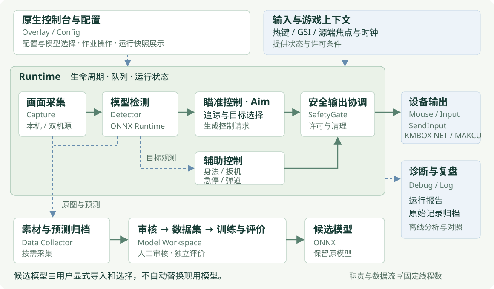
</p>

- **实时链路**：采集、推理与控制在 Runtime 中协作，设备输出受统一许可与清理流程约束。
- **模型闭环**：素材与预测用于审核和训练；候选由用户显式采用，不自动替换正在使用的模型。双机部署的训练作业在主机执行。
- **诊断链路**：运行报告和原始记录用于离线分析，帮助区分图像、推理、控制与设备回执问题。

## 构建与开发

核心技术栈：**C++20 · CMake · ONNX Runtime · OpenCV · Dear ImGui · spdlog**。

需要 Windows x64、带 C++ 桌面开发组件的 Visual Studio 2026 / MSVC v14.51、CMake 4.2+（下例 VS 2026 生成器所需）、ONNX Runtime SDK 和 OpenCV。启用测试时，还需 Git、PowerShell 7，以及可导入 NumPy、OpenCV 的 Python 3；配置阶段会记录工具绝对路径，供干净 PATH 的测试使用。

```powershell
$env:ONNXRUNTIME_ROOT = "C:\path\to\onnxruntime"
$env:OpenCV_DIR = "C:\path\to\opencv\build\x64\vc16\lib"
$buildDirectory = "build/nvidia" # 按所选 ORT 后端改为 build/directml 或 build/openvino

cmake -S . -B $buildDirectory -G "Visual Studio 18 2026" -A x64 `
  -DONNXRUNTIME_ROOT="$env:ONNXRUNTIME_ROOT" `
  -DOpenCV_DIR="$env:OpenCV_DIR" `
  -DBUILD_TESTING=ON

cmake --build $buildDirectory --config Release --target xen_app --parallel
```

输出为所选构建目录下的 `Release/Xen.exe`。CUDA、TensorRT、DirectML、OpenVINO 和 NDI 需使用匹配 SDK；各推理发行包使用独立构建目录。完整构建、运行库核验与发布参见[开发指南](assets/guide/development.md)。

## 仓库结构

下面列出主要源码与公开资料。各模块如何协作见[项目架构](#项目架构)，定位具体功能见[开发指南的代码导航](assets/guide/development.md#源码与验证)。

```text
仓库根目录/
├── Xen/                         C++ 应用与主要功能模块（选列）
│   ├── app/                     应用入口、启动器与输入路由
│   ├── overlay/                 原生界面与功能面板
│   ├── config/                  配置读取、保存与校验
│   ├── capture/                 本机、网络及 NDI 画面输入
│   ├── sender/                  双机画面发送端
│   ├── detector/                模型推理、预处理与后处理
│   ├── aim/                     目标追踪、选择与瞄准控制
│   ├── runtime/                 生命周期、队列、安全门与助手协作
│   ├── mouse/                   鼠标及设备输出后端
│   ├── keyboard/                热键、物理状态与共享键盘输出
│   ├── trigger/                 自动扳机
│   ├── auto_stop/               急停策略与事务
│   ├── recoil/                  弹道档案与执行
│   ├── movement/                旋转跳、Long Jump 与动作清理
│   ├── weapon/                  武器资料与 GSI
│   ├── data_collection/         素材与预测采集
│   ├── model_workspace/         审核、数据集、训练与候选管理
│   ├── source_context/          双机源端状态与焦点
│   ├── clock_sync/              时钟同步与时间映射
│   ├── debug/                   运行记录与诊断数据
│   ├── debug_session/           调试会话与工具编排
│   ├── log/                     日志输出
│   └── crash/                   崩溃诊断
├── scripts/                     正式构建、运行、发布与分析入口
│   ├── review_run.py            单 Run 离线复盘
│   ├── model_data_pipeline.py   素材审核与数据集处理
│   └── model_data_review.html   批量审核页面
├── tests/                       单元、集成、契约测试
│   ├── README.md               当前测试入口与历史报告索引
│   └── fixtures/               测试素材与夹具
├── assets/
│   ├── config/                 可恢复的完整发行默认配置
│   ├── guide/                  控制、身法、训练、助手与开发指南
│   ├── readme/                 UI 截图、架构 SVG 与来源说明
│   │   └── showcase/           压枪、追踪和身法 GIF
│   ├── recoil/                 弹道导入说明与清单
│   └── reference_assessment/   参考评估示例与第三方许可
├── .github/                    文档检查工作流、问题与 PR 模板
├── CMakeLists.txt              依赖、构建目标与测试登记
├── CONTRIBUTING.md             贡献与验证说明
├── SUPPORT.md                  使用帮助与排查入口
├── SECURITY.md                 安全问题报告方式
├── LICENSE                     MIT 许可证
└── README.md                   项目介绍与使用入口
```

专项探针、基准、校准与离线研究目录按用途列在[开发指南](assets/guide/development.md#工具与测试的位置)。`docs/` 与 `AGENTS.md` 仅本地维护；`build/`、`cache/`、`logs/`、`temp/`、`tmp/` 和本机 `config.ini` 不进入公开源码。任务临时产物统一使用 `temp/<任务ID>/`。发布包的目录布局另见[运行与发布目录](assets/guide/development.md#应用启动与发布布局)。

## 使用指南

| 指南 | 内容 |
| :-- | :-- |
| [采集、审核与训练](assets/guide/training.md) | 从素材整理到训练环境、模型评价与候选管理。 |
| [身法简明说明](assets/guide/movement.md) | 旋转跳与 Long Jump 的入口、触发与演示。 |
| [瞄准、辅助与弹道](assets/guide/controls.md) | 控制设置、阵营筛选、自动扳机、急停与弹道工作流。 |
| [录制、分析与实验工具](assets/guide/tools.md) | 输入评价、离线对照、有界测试及命令参数。 |
| [构建与开发](assets/guide/development.md) | 依赖、可执行目标、脚本入口、运行目录和诊断。 |
| [独立参考评估](assets/reference_assessment/GUIDE.md) | 参考评分与 Xen 输入评估的并列比较。 |
| [源码更新与验证](assets/guide/releases/2026-10-12.md) · [测试报告索引](tests/README.md) | 已合入功能、构建与交付范围，以及各日期的原始专项说明。 |

## 反馈与贡献

| 需要什么 | 入口 |
| :-- | :-- |
| 使用帮助与排查 | 本页[使用指南](#使用指南) · [支持说明](SUPPORT.md) |
| 查看源码更新与验证范围 | [2026-10-12 更新记录](assets/guide/releases/2026-10-12.md)；历史 Release 保留各自版本说明。 |
| 报告故障或提出建议 | [问题模板](https://github.com/hpsazz1/Xen/issues/new/choose) |
| 提交代码或改进文档 | [贡献指南](CONTRIBUTING.md) |
| 报告安全漏洞 | [安全政策与私密渠道](SECURITY.md) |
| 了解社区交流规范 | [行为准则](CODE_OF_CONDUCT.md) |

反馈时请说明提交或包版本、推理后端、画面来源、复现步骤与预期行为，并附脱敏日志或截图。不要上传设备凭据、个人配置或未经许可的数据。

公开文档由 GitHub Actions 检查本地链接和基本格式。代码修改优先构建受影响目标并运行相关测试；构建测试、离线评价和真实设备验收分别记录。

## 致谢与许可说明

感谢 ONNX Runtime、OpenCV、Dear ImGui、spdlog、SimpleIni、nlohmann/json 及相关项目。独立输入评估参考的 cs-match-hud 许可与来源保存在 [reference_assessment](assets/reference_assessment/)。

Xen 原创源码及随附文档采用 [MIT License](LICENSE)，允许使用、修改、商用和再分发，须保留版权及许可声明；软件按原样提供，不提供担保。

第三方代码、依赖及另有声明的材料仍遵循各自许可证。项目的 MIT 授权不替代模型权重、外部数据或其他第三方素材的授权；使用与分发这些材料时需另行核对。
